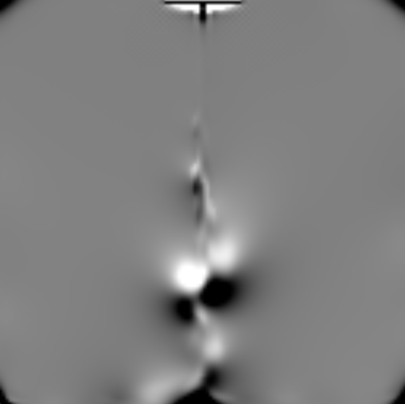
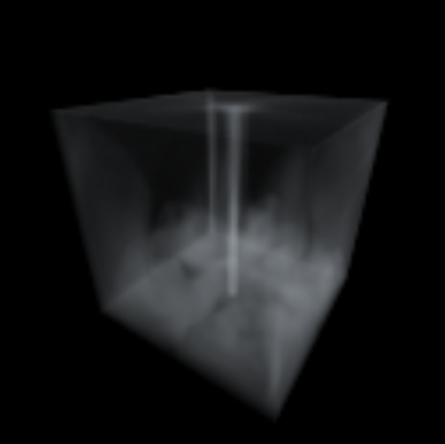

# MiniFluid

A C++ and CUDA implementation of grid-based incompressible flow for smoke simulation. MiniFluid combines a three-dimensional staggered MAC grid, semi-Lagrangian advection, pressure projection, and CUDA volume rendering in an interactive SDL3 application.

The default scene continuously injects smoke and upward velocity near the bottom center of a closed domain. The repository also contains CPU implementations of the 2D and 3D solvers for studying the numerical methods alongside the GPU implementation.

## Features

- **CUDA simulation:** velocity advection, source injection, boundary enforcement, divergence computation, Jacobi pressure iterations, pressure-gradient subtraction, and density advection.
- **Staggered MAC grid:** face-centered velocity components with cell-centered pressure and smoke density.
- **Semi-Lagrangian transport:** first-order backtracing and trilinear interpolation in the 3D CUDA solver.
- **GPU volume rendering:** ray-box intersection, trilinear density sampling, front-to-back opacity accumulation, and early ray termination.
- **Interactive inspection:** camera movement, mouse look, pause, divergence slices, texture filtering, and BMP screenshots.
- **Development utilities:** timing logs and a CPU/CUDA divergence comparison routine.

<!--   -->
<table>
  <tr>
    <td align="center">
      <br>
      <em>A 2D FLuid Example</em>
    </td>
    <td align="center">
      <br>
      <em>Divergence of the 2D Fluid</em>
    </td>
    <td colspan="2" align="center">
      <br>
      <em>3D FLuid Volume Rendering</em>
    </td>
  </tr>
</table>


## Build and Run

### Requirements

The current build targets Windows and requires:

- An NVIDIA GPU with CUDA support and a compatible driver.
- The NVIDIA CUDA Toolkit, including CUDA integration for the chosen Visual Studio installation.
- Visual Studio with the Desktop development with C++ workload and a Windows SDK. The supplied presets select **Visual Studio 18 2026**; the CUDA Toolkit must support the selected host compiler.
- CMake with support for the selected Visual Studio generator. The top-level project declares CMake 3.20, while the checked-out DirectXTK12 dependency requires at least 3.21.
- Git for retrieving the repository and dependencies.

The project uses C++20 for C++ sources and CUDA C++17 for CUDA sources. SDL3 provides the window, input handling, and texture presentation. DirectXTK12 supplies the SimpleMath types used by the camera and CPU code; volume rendering itself is implemented in CUDA.

### Get the Source

```powershell
git clone --recurse-submodules https://github.com/Arcodius/MiniFluid.git
cd MiniFluid
```

For an existing checkout:

```powershell
git submodule update --init --recursive
```

Both `external/SDL/CMakeLists.txt` and `external/DirectXTK12/CMakeLists.txt` must exist before configuration. SDL is listed in `.gitmodules`, but the current repository revision does not track an SDL submodule commit. If `external/SDL` is missing after cloning, retrieve it separately:

```powershell
git clone https://github.com/libsdl-org/SDL.git external/SDL
```

This fallback retrieves SDL's current default branch; the repository does not currently pin its revision.

### Configure and Build

From the repository root:

```powershell
cmake --preset release
cmake --build --preset release
```

Launch the executable:

```powershell
.\build\Release\Release\MiniFluid.exe
```

The nested `Release` directory is expected: the preset uses `build/Release` as its build directory, and Visual Studio adds the configuration directory beneath it. The build copies the SDL runtime library beside the executable. The CUDA shared runtime must also be available at launch.

If you use a different Visual Studio installation, configure a separate build directory with a generator supported by both CMake and your CUDA Toolkit, then build the `Release` configuration.

> The `release-cpu` preset currently changes only the build directory. It builds the same CUDA-enabled executable and does not select a CPU backend. The application instantiates `CudaFluidSolver` directly in `src/main.cpp`.

## Controls

| Input | Action |
| --- | --- |
| `W` / `S` | Move the camera forward / backward |
| `A` / `D` | Move the camera left / right |
| Hold right mouse button and drag | Rotate the camera |
| Mouse wheel | Adjust the perspective field of view |
| `Space` | Pause or resume the simulation |
| `V` | Switch between volume-rendered density and a grayscale divergence slice |
| `Up` / `Down` | Increase / decrease the divergence slice's Z index |
| `M` | Toggle linear / nearest-neighbor texture scaling |
| `P` | Save a screenshot beside the executable |
| `Esc` | Exit |

Screenshots use the first available name in the sequence `screenshot_1.bmp`, `screenshot_2.bmp`, and so on. Camera controls and display changes remain available while the simulation is paused.

## Simulation Method

For a grid of `nx × ny × nz` cells, pressure and smoke density are stored at cell centers. Velocity components occupy the corresponding cell faces:

| Field | Dimensions |
| --- | --- |
| Pressure, smoke density, divergence | `nx × ny × nz` |
| X velocity (`u`) | `(nx + 1) × ny × nz` |
| Y velocity (`v`) | `nx × (ny + 1) × nz` |
| Z velocity (`w`) | `nx × ny × (nz + 1)` |

Each CUDA simulation step performs the following operations:

1. Advect the three velocity components through the current velocity field.
2. Inject upward velocity and smoke density at the source.
3. Call the external-force hook, which is currently empty.
4. Set normal velocity to zero at the domain walls.
5. Compute the discrete velocity divergence.
6. Reset pressure and run 100 Jacobi iterations for the pressure Poisson equation.
7. Subtract the pressure gradient from velocity.
8. Advect smoke density using the projected velocity field.

The pressure projection approximates incompressibility through

```text
Laplacian(p) = (rho / dt) * divergence(u*)
u_new        = u* - (dt / rho) * gradient(p)
```

Here, `rho` is the constant fluid density used by the pressure solve. The transported smoke density is a separate scalar field used for visualization.

The application advances simulation time in fixed `1/60`-second steps, with at most four simulation steps per rendered frame. It caps frame-time accumulation and discards remaining backlog after reaching that limit, so simulation time can advance more slowly than wall-clock time under heavy load.

### Rendering

The CUDA renderer marches a ray through the density volume for each output pixel, using a step size of half a grid cell. It accumulates a fixed smoke color with density-dependent opacity and terminates when transmittance falls below `0.01`. The resulting image is copied to CPU memory, uploaded to an SDL texture, and scaled to the window.

The divergence view displays values in the range `[-1, 1]` as grayscale, with zero mapped to mid-gray. It reads the divergence computed **before pressure projection**. To inspect the projected field, enable the commented `computeDivergence()` call after `applyPressureGradient()` in `CudaFluidSolver::step()`.

## Configuration

Settings are currently defined in source code and require rebuilding.

| Setting | Default | Location |
| --- | --- | --- |
| Simulation grid | `128 × 128 × 128` | `SIM_WIDTH`, `SIM_HEIGHT`, `SIM_DEPTH` in `src/main.cpp` |
| Cell spacing | `1 / SIM_WIDTH` | Solver construction in `src/main.cpp` |
| Fluid density for projection | `1.0` | Solver construction in `src/main.cpp` |
| Window size | `512 × 512` | `WINDOW_WIDTH`, `WINDOW_HEIGHT` in `src/main.cpp` |
| Volume render resolution | `128 × 128` | `CudaRenderer` construction in `OnInit()` |
| Simulation time step | `1/60` second | `simulation_dt` in `loop()` |
| Maximum simulation steps per frame | `4` | `max_step_per_frame` in `loop()` |
| Pressure iterations | `100` | `solvePressure(dt, 100)` in `src/cuda/cuda_fluid_solver.cu` |
| Source velocity / smoke density | `1.0` / `1.0` | Source calls in `CudaFluidSolver::step()` |

Changing the render resolution independently also requires updating the host framebuffer and SDL texture dimensions to match.

## Repository Layout

```text
MiniFluid/
├── CMakeLists.txt                 # Executable, dependencies, and runtime copying
├── CMakePresets.json              # Visual Studio configure/build presets
├── external/
│   ├── SDL/                      # SDL3
│   └── DirectXTK12/              # DirectX Tool Kit and SimpleMath
└── src/
    ├── main.cpp                  # Application loop, controls, and display modes
    ├── camera.h / camera.cpp     # Camera movement and ray generation
    ├── grid.h / grid.cpp         # CPU/device grids, MAC layouts, and buffers
    ├── fluid_math.h / .cpp       # Numerical and interpolation helpers
    ├── fluid_solver_2d.h / .cpp  # CPU 2D solver
    ├── fluid_solver_3d.h / .cpp  # CPU 3D solver
    ├── log_profile.py            # Timing-log summary utility
    └── cuda/
        ├── cuda_fluid_solver.*   # CUDA 3D simulation
        ├── cuda_renderer.*       # CUDA volume ray marching
        ├── cuda_check.*          # CUDA checks and timing utilities
        ├── divergence_cuda.*     # Standalone CUDA divergence computation
        └── divergence_check.cpp # CPU/CUDA divergence comparison routine
```

## Profiling and Validation Utilities

The active `TIME(...)` instrumentation appends timings in microseconds to `profile.log` in the application's working directory. It synchronizes the default CUDA stream before recording elapsed time, and writes logs for individual simulation stages as well as the complete simulation step and rendering. These synchronization points and file writes contribute to runtime overhead.

`CUDA_TIME(...)` is also available for CUDA-event timing and writes to `profile_cuda.log` when used. The current simulation step uses `TIME(...)`.

Both macros are controlled by the CMake option `PROFILE` (default `OFF`). When it is off, they expand to the wrapped call only, with no synchronization or logging. Build a profiling binary with the `release-profile` preset:

```
cmake --preset release-profile
cmake --build --preset release-profile
```

Or set the option manually: `cmake -DPROFILE=ON ...`.

The optional Python utility summarizes timings, discards the first 25% of log lines as warm-up, and reports sample counts, averages, and totals:

```powershell
python src/log_profile.py
```

Its current input path is hard-coded to `build/Release/profile.log`. Run the application with `build/Release` as its working directory, or change that path to the location of your log before running the script. Python is only needed for this utility.

`src/cuda/divergence_check.cpp` contains `main_check_divergence()`, which compares CPU and CUDA divergence on a `17 × 11 × 7` grid with a maximum absolute error tolerance of `1e-5`. This routine is compiled into the application but is not called by the default entry point or registered as a separate test target.

## Current Scope

The implemented demo uses a dense grid, a fixed source, and closed domain walls. The CUDA external-force hook is empty, so the upward motion comes from injected velocity; buoyancy and vorticity confinement are not currently implemented. Pressure projection uses a fixed iteration count without a convergence stopping criterion, so residual divergence can remain. The renderer uses opacity accumulation without volumetric lighting or shadows.

The CPU solvers are available in the source tree, but the current application has no runtime backend selector or CPU-only build option.
