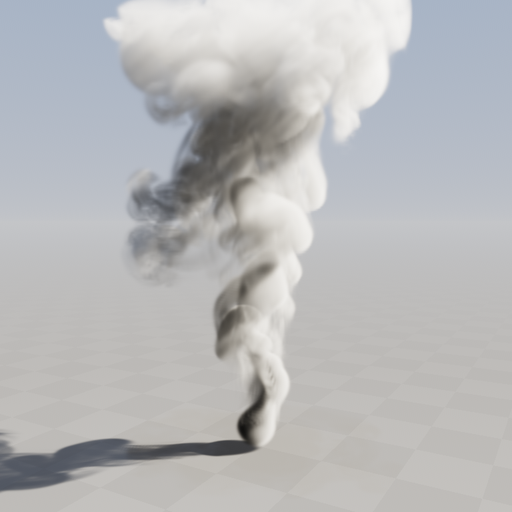
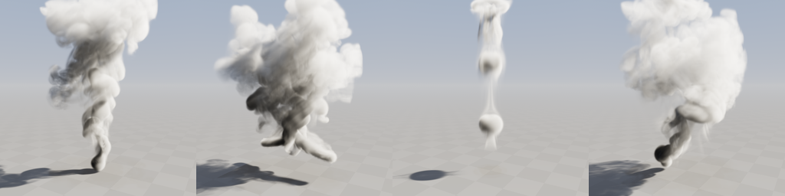

# MiniFluid: Real-Time 3D Smoke Simulation and Volume Rendering on the GPU

*CSCI 596 Final Project (preliminary)*

MiniFluid is an interactive smoke simulator written in C++ and CUDA. It solves the incompressible Euler equations on a 3D grid with about 3.1 million cells (128 × 192 × 128), and it renders the smoke with lighting and shadows, all on the GPU, at interactive frame rates.

<p align="center">
  
</p>

<p align="center">
  <br>
  <em>Built-in scenes: buoyant plume, colliding jets, smoke rings, wandering source</em>
</p>

## Problem

Grid-based fluid simulation is expensive. Every time step advects several fields over millions of cells and then solves a Poisson equation for pressure, the step that keeps the flow incompressible. A single-threaded CPU solver takes seconds per step at this resolution. Rendering the result adds more work, because each pixel marches a ray through the volume and each sample needs the light reaching it through the smoke.

**Goal:** run both the simulation and the lit volume rendering at real-time rates (≥ 60 simulation steps/s) by mapping every stage onto the GPU with CUDA, and measure where the time goes.

## Method

### Simulation (one CUDA step)

The solver uses a staggered MAC grid. Velocity components live on cell faces; pressure, smoke density and temperature live at cell centers.

1. **Advect velocity:** semi-Lagrangian advection with an RK2 (midpoint) backtrace.
2. **Apply emitters:** spherical or disk sources whose density, temperature and velocity are modulated by animated noise.
3. **Add forces:** Boussinesq buoyancy `f = βT − αs` and vorticity confinement, which puts back small swirls that numerical dissipation removes.
4. **Pressure projection:** solve `∇²p = (ρ/Δt) ∇·u*`, then subtract `∇p`, using a warm-started **geometric multigrid V-cycle**.
5. **Advect scalars:** MacCormack advection for density and temperature, with a limiter, so smoke edges stay sharp.

Boundaries are open (smoke leaves through the top and sides) with a solid floor. Static obstacles are described by signed distance fields (SDFs); the default setup places a solid sphere in the domain.

### Parallelization strategy

| Stage | How it is parallelized |
| --- | --- |
| Advection, forces, divergence, gradient | One CUDA thread per cell or face. Every thread is independent (a stencil or gather), so there are no atomics |
| Pressure solve | **Red-black Gauss–Seidel** smoothing: same-color cells do not depend on each other, so each half-sweep updates all of them in parallel. Grids are restricted down to a 4 × 6 × 4 coarse level, and the correction is interpolated back trilinearly. Two V-cycles per step reduce max divergence from ~26 to ~0.06 |
| Diagnostics | GPU parallel reductions (max/RMS divergence, residual, energy, mass), sampled without stalling the pipeline |
| Light volume | One thread per cell marches toward the sun (self-shadowing). Sky occlusion uses a parallel prefix sum along each column. The volume is rebuilt only when the density or the light changes |
| Ray marching | One thread per pixel. Density is bound to a 3D CUDA texture, so the hardware does trilinear filtering |
| Temporal upsampling (TAAU) | The image is ray-marched at 1/N resolution with per-frame sub-pixel jitter. History is reprojected with camera and fluid motion vectors and accumulated at full resolution, with rejection of stale history |
| Display | **CUDA–D3D11 graphics interop**: the finished frame is copied device-to-device into the texture that SDL draws, so it never crosses PCIe to the host and back. The copy is asynchronous, so the CPU no longer stalls on it |

Lighting uses a Henyey–Greenstein phase function, a 3-octave multiple-scattering approximation, sky ambient light, floor shadows and ACES tone mapping.

### Tools

CUDA C++17, C++20, CMake, SDL3 (window and input), Dear ImGui (in-app profiler), CUDA events and Nsight Systems for timing.

## Results (preliminary)

All timings are on an NVIDIA RTX 3070 with the 128 × 192 × 128 grid and a 768 × 768 output, unless noted otherwise.

### Simulation cost per step

| Stage | GPU time (ms) |
| --- | --- |
| Velocity + scalar advection | _TBD_ |
| Forces (buoyancy, vorticity) | _TBD_ |
| Pressure solve (2 V-cycles) | _TBD_ |
| Divergence, projection, boundaries | _TBD_ |
| **Total per step** | _TBD_ |

### CPU vs. GPU

| Grid | CPU 3D solver (ms/step) | CUDA solver (ms/step) | Speedup |
| --- | --- | --- | --- |
| 64 × 96 × 64 | _TBD_ | _TBD_ | _TBD_ |
| 128 × 192 × 128 | _TBD_ | _TBD_ | _TBD_ |

*(Figure TBD: step time vs. grid size, CPU vs. GPU)*

### Rendering: effect of TAAU render scale

Paused simulation, ray-march step of 1 cell, 10 s average. Measured before interop was added (host readback into pageable memory):

| Render scale | Ray march (ms) | FPS | 1% low FPS |
| --- | --- | --- | --- |
| 1/1 (native) | 1.67 | 343 | 246 |
| 1/2 | 1.08 | 437 | 325 |
| 1/3 | 0.66 | 542 | 331 |
| 1/4 | 0.60 | 565 | 330 |

*(Figure TBD: image quality at each render scale, compared with native)*

### Rendering: host readback vs. CUDA–D3D11 interop

Originally every frame was copied to the host (`cudaMemcpy`), then uploaded back to the GPU into the SDL texture. With interop, CUDA writes into that texture directly.

**Before and after.** Same settings as the table above. The "before" column is the pageable-memory build, so the gain includes switching the host buffer to pinned memory as well as interop:

| Render scale | Frame time, before (ms) | Frame time, interop (ms) | FPS, before → interop | Speedup |
| --- | --- | --- | --- | --- |
| 1/1 (native) | 2.92 | 1.39 | 343 → 717 | 2.1× |
| 1/2 | 2.29 | 1.01 | 437 → 992 | 2.3× |
| 1/3 | 1.85 | 0.93 | 542 → 1075 | 2.0× |
| 1/4 | 1.77 | 0.88 | 565 → 1136 | 2.0× |

**Interop alone (controlled A/B).** One build, run with and without `--no-interop` (pinned-memory readback). Runs alternated A/B/A/B, twice per mode. Each run pre-rolls 300 steps, then stays paused with the render limit off for 10 s. GPU clocks were logged with `nvidia-smi`.

| Render scale | Frame time, readback (ms) | Frame time, interop (ms) | Speedup | Ray march, readback → interop (ms) |
| --- | --- | --- | --- | --- |
| 1/1 (native) | 2.08 | 1.52 | 1.37× | 1.07 → 0.74 |
| 1/4 | 1.51 | 0.90 | 1.68× | 0.56 → 0.24 |

- **Copy and upload:** readback dropped from 0.25–0.27 ms (pinned) to 0.017 ms, and upload from 0.27–0.29 ms to 0.09–0.14 ms.
- **No CPU stall:** the CPU no longer waits on the copy, so the UI and present overlap with GPU work.
- **Ray march also got faster, though its kernel did not change.** It is not a clock effect: both modes held the same 1935–1950 MHz (P2). The likely cause is that, with readback, the previous frame's D3D11 work (texture upload, draw, present) is still on the GPU when the next ray march starts. The two contexts then time-slice, and the CUDA event timing includes that time. Not yet confirmed with Nsight Systems.
- **1% low:** above about 1000 FPS, 1% low FPS depends on occasional present stalls of about 3 ms, not on rendering cost.

### Expected results

- The whole simulation step runs in a few milliseconds, which leaves room for real-time simulation plus rendering.
- The CUDA solver runs orders of magnitude faster than the CPU reference solver, and the speedup grows with grid size.
- The multigrid pressure solve keeps divergence low at a fixed, small cost per step. Plain Jacobi iteration would need many more iterations for the same result.
- TAAU lowers ray-marching cost by about 3× with little visible loss in quality.

## Build and Run

**Requirements:** Windows, an NVIDIA GPU, CUDA Toolkit, Visual Studio 2026 (C++ workload), CMake ≥ 3.21 and Git.

```powershell
git clone --recurse-submodules https://github.com/Arcodius/MiniFluid.git
cd MiniFluid
# If external/SDL is empty:
git clone https://github.com/libsdl-org/SDL.git external/SDL

cmake --preset release
cmake --build --preset release
.\build\Release\Release\MiniFluid.exe
```

For older (Pascal) GPUs, use the `-laptop` presets (CUDA 12.9, v143 toolset, `sm_61`).

**Useful options**

| Option | Effect |
| --- | --- |
| `--preset <1-4>` | Start with the given scene |
| `--capture <steps> [file.png]` | Simulate `<steps>` steps offline, save one frame, print timings and exit |
| `--start-steps <N>` / `--exit-steps <M>` | Pre-roll `N` steps, then start paused / exit after `M` steps |
| `--profile` / `--profile-record <file.csv>` | Open the profiler / record per-frame timings to CSV |
| `--no-interop` | Use the host readback path instead of CUDA–D3D11 interop (for comparison, or when interop is unavailable) |
| `--render-scale <1-4>` | Ray-march at 1/N resolution (TAAU) |
| `--no-render-limit` | Start with the render frame-rate limit off |
| `--exit-after <seconds>` | Exit after this much wall-clock time, also while paused (unattended benchmarks) |

`python src/log_profile.py <file.csv>` summarizes a recording and plots charts of it.

**Controls:** `WASD` + right-drag moves the camera · `1`–`4` change the scene · `Space` pauses · `R` resets · arrow keys / `PgUp` / `PgDn` move the sun · `L` toggles lit/unlit · `F` toggles emission · `F1` opens the profiler · `F2` opens frame-rate and render settings · `P` saves a screenshot.

## Repository Layout

```text
src/
├── main.cpp                # App loop, controls, command-line options
├── scene_presets.*         # Built-in scenes
├── fluid_solver_2d/3d.*    # CPU reference solvers
├── profile/                # Frame profiler and ImGui window
├── log_profile.py          # Profiler CSV analysis
└── cuda/
    ├── cuda_fluid_solver.* # CUDA simulation and multigrid pressure solve
    └── cuda_renderer.*     # Light volume, ray marching, TAAU
```

## Next Steps

- Benchmark the CPU solver against the CUDA solver and fill in the speedup table.
- Run a scaling study over grid sizes and compare the cost of multigrid with Jacobi iteration.
- Skip empty space during ray marching.

## References

1. R. Fedkiw, J. Stam, H. W. Jensen. *Visual Simulation of Smoke.* SIGGRAPH 2001.
2. R. Bridson. *Fluid Simulation for Computer Graphics*, 2nd ed. CRC Press, 2015.
3. A. Selle et al. *An Unconditionally Stable MacCormack Method.* J. Sci. Comput., 2008.
4. B. Karis. *High-Quality Temporal Supersampling.* SIGGRAPH 2014 Advances in Real-Time Rendering.
