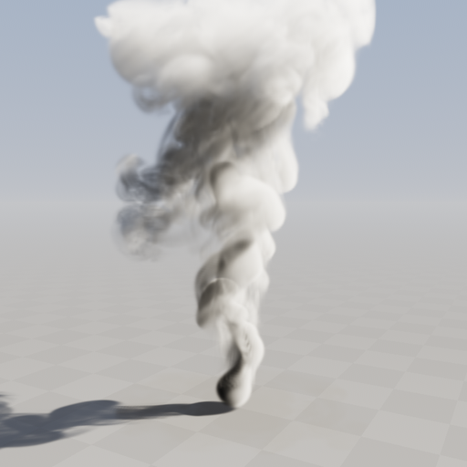
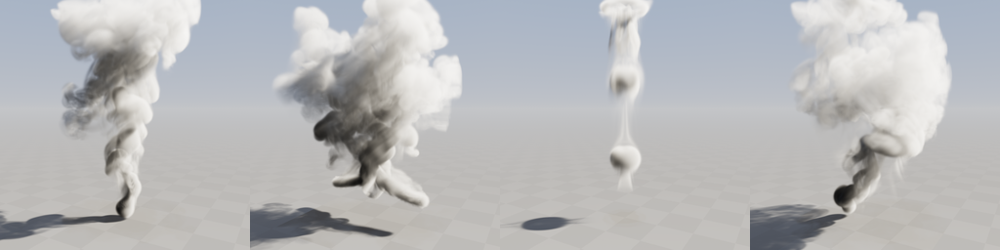
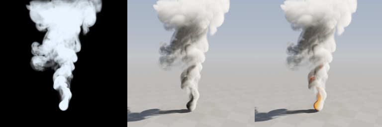

# MiniFluid

A C++ and CUDA implementation of grid-based incompressible flow for smoke simulation. MiniFluid combines a three-dimensional staggered MAC grid, buoyant smoke with vorticity confinement, a multigrid pressure projection, and a CUDA volume renderer with single- and multiple-scattering lighting and volumetric shadows in an interactive SDL3 application.

The default scene is a hot, buoyant plume rising from a noisy source on the floor and breaking up into turbulent billows. Three more scenes (colliding jets, pulsed vortex rings, and a wandering source) are a key press away. The repository also contains CPU implementations of the 2D and 3D solvers for studying the numerical methods alongside the GPU implementation.

<p align="center">
  
</p>

<p align="center">
  <br>
  <em>Scenes 1–4: buoyant plume, colliding jets, smoke rings, wandering source</em>
</p>

## Features

- **Buoyant smoke:** temperature and smoke density fields drive a Boussinesq buoyancy force; temperature cools and smoke dissipates over time.
- **Rich small-scale detail:** vorticity confinement re-injects the swirling motion that numerical dissipation removes, MacCormack advection keeps density and temperature sharp, and a second-order (midpoint) backtrace follows curved streamlines.
- **Animated emitters:** spherical or disk-shaped sources whose injected density, temperature, and velocity are modulated by animated noise, with optional orbiting motion and pulsing.
- **Multigrid pressure solve:** a warm-started, cell-centered geometric multigrid V-cycle with red-black Gauss-Seidel smoothing, about 15x residual reduction per cycle.
- **Open boundaries:** smoke leaves through the top and sides of the domain instead of piling up against walls; the floor is solid.
- **Lit volume rendering:** precomputed light volume (optical depth toward the sun and the sky), Henyey-Greenstein phase function, an octave-based multiple-scattering approximation, sky ambient light, a floor that receives smoke shadows, sky background, ACES tone mapping, and an optional temperature-driven glow.
- **Staggered MAC grid:** face-centered velocity components with cell-centered pressure, temperature, and smoke density.
- **Interactive inspection:** camera movement, mouse look, movable sun, scene presets, pause/reset, divergence slices, and BMP screenshots.
- **Development utilities:** offline capture mode, timing logs, and a CPU/CUDA divergence comparison routine.

<p align="center">
  <br>
  <em>The same frame unlit (<code>L</code>), lit (default), and with temperature emission (<code>F</code>)</em>
</p>

<details>
<summary>Earlier results</summary>
<table>
  <tr>
    <td align="center">
      <br>
      <em>A 2D Fluid Example</em>
    </td>
    <td align="center">
      <br>
      <em>Divergence of the 2D Fluid</em>
    </td>
    <td colspan="2" align="center">
      <br>
      <em>First 3D Fluid Volume Rendering</em>
    </td>
  </tr>
</table>
</details>

## Build and Run

### Requirements

The current build targets Windows and requires:

- An NVIDIA GPU with CUDA support and a compatible driver.
- The NVIDIA CUDA Toolkit, including CUDA integration for the chosen Visual Studio installation.
- Visual Studio with the Desktop development with C++ workload and a Windows SDK. The supplied presets select **Visual Studio 18 2026**; the CUDA Toolkit must support the selected host compiler.
- CMake with support for the selected Visual Studio generator. The top-level project declares CMake 3.20, while the checked-out DirectXTK12 dependency requires at least 3.21.
- Git for retrieving the repository and dependencies.

The project uses C++20 for C++ sources and CUDA C++17 for CUDA sources. SDL3 provides the window, input handling, and texture presentation. DirectXTK12 supplies the SimpleMath types used by the camera and CPU code; simulation and rendering are implemented in CUDA.

### Get the Source

```powershell
git clone --recurse-submodules https://github.com/Arcodius/MiniFluid.git
cd MiniFluid
```

For an existing checkout:

```powershell
git submodule update --init --recursive
```

Both `external/SDL/CMakeLists.txt` and `external/DirectXTK12/CMakeLists.txt` must exist before configuration. SDL is listed in `.gitmodules`, but the current repository revision does not track an SDL submodule commit. If `external/SDL` is missing after cloning, retrieve it separately:

```powershell
git clone https://github.com/libsdl-org/SDL.git external/SDL
```

This fallback retrieves SDL's current default branch; the repository does not currently pin its revision.

### Configure and Build

From the repository root:

```powershell
cmake --preset release
cmake --build --preset release
```

Launch the executable:

```powershell
.\build\Release\Release\MiniFluid.exe
```

The nested `Release` directory is expected: the preset uses `build/Release` as its build directory, and Visual Studio adds the configuration directory beneath it. The build copies the SDL runtime library beside the executable. The CUDA shared runtime must also be available at launch.

If you use a different Visual Studio installation, configure a separate build directory with a generator supported by both CMake and your CUDA Toolkit, then build the `Release` configuration.

> The `release-cpu` preset currently changes only the build directory. It builds the same CUDA-enabled executable and does not select a CPU backend. The application instantiates `CudaFluidSolver` directly in `src/main.cpp`.

### Command-Line Options

| Option | Effect |
| --- | --- |
| `--preset <1-4>` | Start with the given scene |
| `--unlit` | Start with the unlit renderer |
| `--emission` | Start with temperature emission enabled |
| `--capture <steps> [file.bmp]` | Run `<steps>` simulation steps of `1/60` s without real-time pacing, render one frame, save it (default `capture.bmp`), print timings, and exit |

For example, `MiniFluid.exe --preset 2 --capture 420 jets.bmp` saves the colliding-jets scene after seven simulated seconds. The images in `doc/` were produced this way.

## Controls

| Input | Action |
| --- | --- |
| `W` / `S` | Move the camera forward / backward |
| `A` / `D` | Move the camera left / right |
| Hold right mouse button and drag | Rotate the camera |
| Mouse wheel | Adjust the perspective field of view |
| `1` – `4` | Load a scene preset (and reset the simulation) |
| `R` | Reset the current scene |
| `Space` | Pause or resume the simulation |
| `Left` / `Right` | Rotate the sun around the vertical axis |
| `Page Up` / `Page Down` | Raise / lower the sun |
| `L` | Toggle lit rendering / unlit opacity accumulation |
| `F` | Toggle temperature emission (glowing hot smoke) |
| `G` | Toggle the floor |
| `V` | Switch between the volume rendering and a grayscale divergence slice |
| `Up` / `Down` | Increase / decrease the divergence slice's Z index |
| `M` | Toggle linear / nearest-neighbor texture scaling |
| `P` | Save a screenshot beside the executable |
| `Esc` | Exit |

The window title shows the current scene, the frame rate, and whether the simulation is paused. Screenshots use the first available name in the sequence `screenshot_1.bmp`, `screenshot_2.bmp`, and so on. Camera, lighting, and display controls remain available while the simulation is paused.

## Scenes

Scenes are defined in `src/scene_presets.cpp` as a set of `SmokeParameters` plus up to four `SmokeEmitter`s.

| Key | Scene | Description |
| --- | --- | --- |
| `1` | Buoyant plume | A hot source on the floor; buoyancy and vorticity confinement turn the rising column into turbulent billows |
| `2` | Colliding jets | Two horizontal jets from opposite sides collide, mix, and rise |
| `3` | Smoke rings | Short pulses from a thin disk roll up into vortex rings that travel upward |
| `4` | Wandering source | A source orbiting on the floor produces a twisting, leaning plume |

## Simulation Method

For a grid of `nx × ny × nz` cells, pressure, smoke density, and temperature are stored at cell centers. Velocity components occupy the corresponding cell faces:

| Field | Dimensions |
| --- | --- |
| Pressure, smoke density, temperature, divergence | `nx × ny × nz` |
| X velocity (`u`) | `(nx + 1) × ny × nz` |
| Y velocity (`v`) | `nx × (ny + 1) × nz` |
| Z velocity (`w`) | `nx × ny × (nz + 1)` |

Each CUDA simulation step performs the following operations:

1. **Advect velocity** with semi-Lagrangian transport. Departure points use a midpoint (RK2) backtrace; samples are trilinear.
2. **Apply emitters.** Inside each emitter, density and temperature are raised to the emitter's noise-modulated values, and face velocities relax toward the emitter velocity plus a noise perturbation that breaks the plume's symmetry.
3. **Add forces** at cell centers, averaged onto faces:
   - Buoyancy: `f_y = beta * T - alpha * s`, where `T` is temperature and `s` is smoke density.
   - Vorticity confinement: `f = epsilon * h * (N × omega)`, with `omega = curl(u)` and `N = grad|omega| / |grad|omega||`.
   - An optional constant wind acceleration.
4. **Enforce boundaries:** zero normal velocity at the floor and at any closed faces.
5. **Compute the discrete divergence.**
6. **Solve for pressure** with warm-started multigrid V-cycles (two by default).
7. **Subtract the pressure gradient** from velocity.
8. **Advect density and temperature** together with MacCormack advection, then apply smoke dissipation and cooling.

The pressure projection approximates incompressibility through

```text
Laplacian(p) = (rho / dt) * divergence(u*)
u_new        = u* - (dt / rho) * gradient(p)
```

Here, `rho` is the constant fluid density used by the pressure solve. The transported smoke density and temperature are separate scalar fields.

**Multigrid.** The grid is coarsened by factors of two while every dimension stays even and at least 8 (for the default grid: 128×192×128 down to 4×6×4). A V-cycle runs two red-black Gauss-Seidel sweeps before and after the coarse-grid correction. Coarse right-hand sides are 2×2×2 averages of the fine residual, and corrections are interpolated back trilinearly. The coarsest level gets 24 over-relaxed sweeps. Walls are Neumann boundaries. Open faces are zero-pressure Dirichlet boundaries whose ghost cell sits one fine cell outside the domain; each coarse level weights that boundary term so it stays at the same physical location, which keeps the cycle convergent. The previous step's pressure is the initial guess. On the plume scene after five simulated seconds, two cycles reduce the maximum divergence over the grid from about 26 before projection to about 0.06 after it, and four cycles reach about 3e-4.

**MacCormack advection.** A forward semi-Lagrangian step is followed by a backward step; half of the round-trip error is then subtracted. The result is clamped to the range of the eight values the forward step interpolated from, which prevents new extrema. MacCormack is enabled for density and temperature. It is disabled by default for velocity, because combined with vorticity confinement it amplifies grid-scale noise that shows up as grain in the rendering.

The application advances simulation time in fixed `1/60`-second steps, with at most four simulation steps per rendered frame. It caps frame-time accumulation and discards remaining backlog after reaching that limit, so simulation time can advance more slowly than wall-clock time under heavy load.

### Rendering

Each frame, the renderer copies density (and temperature, when emission is on) into 3D CUDA arrays so that rays can use hardware trilinear filtering. It then builds a light volume at simulation resolution with two channels:

- **Sun optical depth:** for every cell, a march toward the sun accumulates `extinction * density * distance`.
- **Sky optical depth:** a per-column prefix sum straight up to the top of the domain, used as a cheap sky-occlusion term.

The main kernel marches each pixel's ray through the volume with a step of half a cell. The starting offset is jittered per pixel with interleaved gradient noise to avoid banding. At each sample with smoke:

- Sun light is `sum_i a^i * phase_i(cos θ) * exp(-b^i * tau_sun)` over three octaves (`a = 0.3`, `b = 0.5`). This approximates multiple scattering: deeper octaves are dimmer, penetrate further, and use a less anisotropic phase.
- Each octave's phase is a mix of a forward Henyey-Greenstein lobe (`g = 0.5` for the first octave) and a weak backward lobe.
- Sky light is the ambient sky color times `exp(-tau_sky)`.
- In-scattering is integrated analytically over the step, `L * (1 - exp(-sigma * ds))`, with albedo `0.85`.
- With emission enabled, temperature above a threshold adds a blackbody-like orange glow.

Rays that leave the volume or reach transmittance below `0.003` composite over the background. The background is either the floor plane at `y = 0` or a sky gradient with a sun halo. The floor is lit by the sun and darkened by a shadow ray marched through the density texture, and beneath the smoke it is also occluded from the sky. The result is exposed, ACES tone-mapped, gamma-encoded, and dithered. The rendered image is copied to CPU memory, uploaded to an SDL texture, and scaled to the window.

The unlit mode (`L`) reproduces the earlier renderer: opacity accumulation of a fixed smoke color over black.

The divergence view displays values in the range `[-1, 1]` as grayscale, with zero mapped to mid-gray and `+y` pointing up. It reads the divergence computed **before pressure projection**. To inspect the projected field, enable the commented `computeDivergence()` call after `applyPressureGradient()` in `CudaFluidSolver::step()`.

### Performance

These measurements come from an RTX 3070 with the default 128×192×128 grid, a 768×768 render, and Nsight Systems kernel timings on the plume scene:

| Stage | GPU time |
| --- | --- |
| Pressure solve (2 V-cycles) | ~2.3 ms |
| Velocity, density, and temperature advection | ~2.2 ms |
| Vorticity confinement and buoyancy | ~1.2 ms |
| Sources, divergence, gradient, boundaries | ~0.6 ms |
| **Simulation step** | **~6.3 ms** |
| Light volume | ~1.4 ms |
| Ray marching | ~0.8 ms |

Interactively, the application runs at roughly 150 frames per second while keeping the simulation in real time.

## Configuration

Grid, window, and timing settings are defined in source code and require rebuilding. Simulation parameters are set per scene in `src/scene_presets.cpp`; defaults are in `SmokeParameters` and `SmokeEmitter` (`src/cuda/cuda_fluid_solver.h`). Lighting defaults are in `LightingSettings` (`src/cuda/cuda_renderer.h`).

| Setting | Default | Location |
| --- | --- | --- |
| Simulation grid | `128 × 192 × 128` | `SIM_WIDTH`, `SIM_HEIGHT`, `SIM_DEPTH` in `src/main.cpp` |
| Cell spacing | `1 / SIM_WIDTH` (domain is 1 × 1.5 × 1 world units) | Solver construction in `src/main.cpp` |
| Fluid density for projection | `1.0` | Solver construction in `src/main.cpp` |
| Window size | `768 × 768` | `WINDOW_WIDTH`, `WINDOW_HEIGHT` in `src/main.cpp` |
| Volume render resolution | `768 × 768` | `RENDER_WIDTH`, `RENDER_HEIGHT` in `src/main.cpp` |
| Simulation time step | `1/60` second | `simulation_dt` in `loop()` |
| Maximum simulation steps per frame | `4` | `max_step_per_frame` in `loop()` |
| Buoyancy (`beta`, `alpha`) | `2.5`, `0.08` | `SmokeParameters::buoyancyTemperature`, `buoyancyDensity` |
| Vorticity confinement (`epsilon`) | `3.0` | `SmokeParameters::vorticity` |
| Smoke dissipation / cooling rate | `0.05` / `0.6` per second | `SmokeParameters::densityDissipation`, `temperatureCooling` |
| Pressure V-cycles per step | `2` | `SmokeParameters::pressureCycles` |
| MacCormack on scalars / velocity | on / off | `SmokeParameters::maccormackScalars`, `maccormackVelocity` |
| Open top / open sides | on / on | `SmokeParameters::openTop`, `openSides` |
| Sun direction | azimuth `320°`, elevation `38°` | `LightingSettings::lightAzimuth`, `lightElevation` |
| Extinction, albedo, phase `g` | `90`, `0.85`, `0.5` | `LightingSettings` |
| Exposure | `0.6` | `LightingSettings::exposure` |

## Repository Layout

```text
MiniFluid/
├── CMakeLists.txt                 # Executable, dependencies, and runtime copying
├── CMakePresets.json              # Visual Studio configure/build presets
├── doc/                           # Images used in this README
├── external/
│   ├── SDL/                      # SDL3
│   └── DirectXTK12/              # DirectX Tool Kit and SimpleMath
└── src/
    ├── main.cpp                  # Application loop, controls, capture mode, and display modes
    ├── scene_presets.h / .cpp    # Built-in smoke scenes
    ├── camera.h / camera.cpp     # Camera movement and ray generation
    ├── grid.h / grid.cpp         # CPU/device grids, MAC layouts, and buffers
    ├── fluid_math.h / .cpp       # Numerical and interpolation helpers
    ├── fluid_solver_2d.h / .cpp  # CPU 2D solver
    ├── fluid_solver_3d.h / .cpp  # CPU 3D solver
    ├── log_profile.py            # Timing-log summary utility
    └── cuda/
        ├── cuda_fluid_solver.*   # CUDA 3D smoke simulation and multigrid pressure solve
        ├── cuda_renderer.*       # Light volume and lit volume ray marching
        ├── cuda_check.*          # CUDA checks and timing utilities
        ├── divergence_cuda.*     # Standalone CUDA divergence computation
        └── divergence_check.cpp # CPU/CUDA divergence comparison routine
```

## Profiling and Validation Utilities

The active `TIME(...)` instrumentation appends timings in microseconds to `profile.log` in the application's working directory. It synchronizes the default CUDA stream before recording elapsed time, and writes logs for individual simulation stages, the complete simulation step, the light-volume update, and rendering. These synchronization points and file writes contribute to runtime overhead.

`CUDA_TIME(...)` is also available for CUDA-event timing and writes to `profile_cuda.log` when used. The current simulation step uses `TIME(...)`.

Both macros are controlled by the CMake option `PROFILE` (default `OFF`). When it is off, they expand to the wrapped call only, with no synchronization or logging. Build a profiling binary with the `release-profile` preset:

```
cmake --preset release-profile
cmake --build --preset release-profile
```

Or set the option manually: `cmake -DPROFILE=ON ...`.

The optional Python utility summarizes timings, discards the first 25% of log lines as warm-up, and reports sample counts, averages, and totals:

```powershell
python src/log_profile.py
```

Its current input path is hard-coded to `build/Release/profile.log`. Run the application with `build/Release` as its working directory, or change that path to the location of your log before running the script. Python is only needed for this utility.

The `--capture` option prints the average time per simulation step and per rendered frame. That gives a quick measurement without a profiling build.

`src/cuda/divergence_check.cpp` contains `main_check_divergence()`, which compares CPU and CUDA divergence on a `17 × 11 × 7` grid with a maximum absolute error tolerance of `1e-5`. This routine is compiled into the application but is not called by the default entry point or registered as a separate test target.

## Current Scope

The simulation uses a dense uniform grid with a solid floor and open top and sides; there are no internal obstacles. The pressure solve runs a fixed number of multigrid cycles without a convergence stopping criterion, so a small residual divergence remains. Velocity uses first-order semi-Lagrangian advection, which still smooths small eddies; vorticity confinement compensates only partly. The light volume is recomputed every frame at simulation resolution. Sky occlusion considers only the column directly above each cell. Multiple scattering is approximated rather than simulated.

The CPU solvers are available in the source tree, but the current application has no runtime backend selector or CPU-only build option.


1. 光照与阴影
渲染部分在 cuda_renderer.cu：

光照体积：每帧为每个网格算出朝向太阳的光学深度（用于自阴影）和朝向天空的光学深度（用于环境遮蔽）。
散射：Henyey-Greenstein 相函数，加上多重散射近似（分 3 级叠加），再叠加天空环境光，积分按步长解析计算。
场景：地面会接收烟雾投下的阴影，背景是带太阳光晕的天空，输出做了 ACES 色调映射。
可选效果：按 F 开启温度发光，热烟会呈现火焰般的橙色；按 L 切回原来的无光照渲染，便于对比。
性能：密度改用 3D 纹理，由硬件做三线性插值；渲染分辨率从 128² 提高到 768²，每帧 GPU 耗时约 2.3 ms。
2. 生动的烟雾
模拟部分在 cuda_fluid_solver.cu：

温度与浮力：新增温度场，热烟会上升，并且温度会逐渐冷却。
涡度约束：把数值耗散掉的旋涡补回来，这是烟雾细节丰富的主要来源。
平流：回溯改为二阶（RK2）；密度和温度改用 MacCormack 平流，边缘更锐利。
发射源：由动画噪声调制，可以是球形或薄盘形，支持绕圈移动和脉冲喷射。
场景预设：共 4 个，在 scene_presets.cpp 中，按 1–4 切换：浮力羽流、对撞射流、烟圈、游走源。
压力求解：100 次 Jacobi 迭代换成了带热启动的多重网格 V-cycle。羽流场景中，投影后的最大散度约为 0.06（投影前约 26），每步只需约 2.3 ms。
开放边界：顶部和四周都开放，烟会离开计算域，不再堆在墙边露出盒子的形状；只有地面是实心的。
步进耗时：网格是 128×192×128，比原来的 128³ 更高，每步约 7 ms（原来是 128³ 网格，约 23 ms）。
开发中需要你知道的
多重网格的开放边界：最初每一层都把零压力的虚拟单元放在一个单元格之外，粗网格上边界位置因此错位，求解在几步之内就发散了。现在每一层按比例调整边界项，使边界停在同一物理位置。
速度场的 MacCormack 默认关闭：它和涡度约束叠加后会放大网格尺度的噪声，画面上表现为颗粒感，所以只对密度和温度启用。这个开关在 SmokeParameters 中。
发射源噪声：噪声原本有一层频率接近网格分辨率，同样会产生颗粒感，已减为两层。